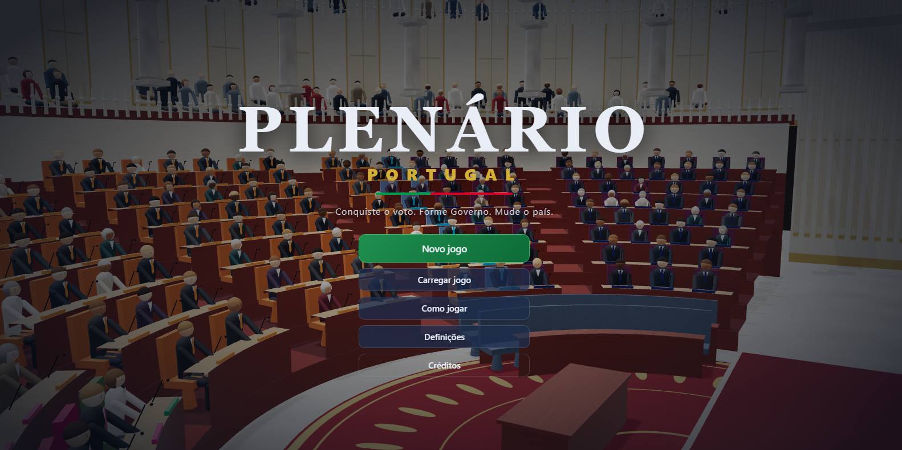
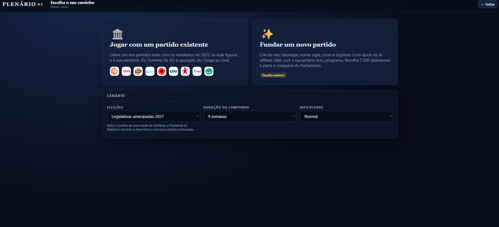
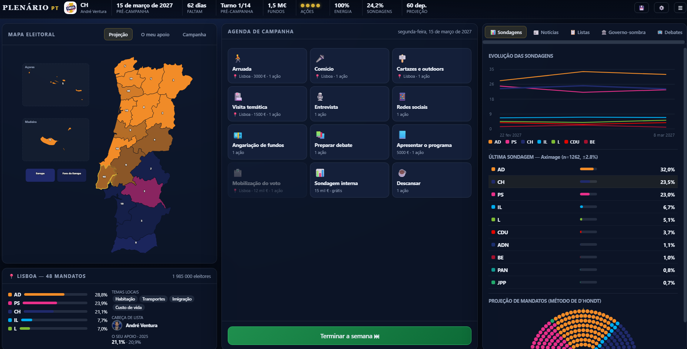

<div align="center">


**Disputa as eleições legislativas portuguesas, forma Governo e governa, ou faz oposição.**


</div>

---

## 📸 Capturas

<div align="center">



*Menu inicial, com a Assembleia da República em 3D*



*Escolher um partido real ou fundar um novo*



*Campanha: mapa dos círculos, agenda de ações, sondagens e projeção de mandatos*

</div>

---

## 🎮 O que é

Um simulador político em 3D que corre no navegador, **sem instalar nada e sem internet**. Escolhes um partido real (ou fundas o teu), fazes campanha, ganhas (ou não) as eleições e depois governas: propões leis, negoceias o Orçamento e lidas com crises.

Inclui a **campanha com debates televisivos, arruadas e cartazes em 3D**, a **noite eleitoral com o método de D'Hondt** e a **Assembleia da República em 3D**.

---

## ✨ Funcionalidades

### 🗳️ Início
- Joga com um **partido real** (AD, PS, Chega, IL, Livre, CDU, BE, PAN, JPP e outros) com logótipos oficiais e resultados reais de 2025, calibrados por círculo
- Ou **funda um partido**: ideologia em 3 eixos, nome, sigla e slogan sugeridos pela IA, logótipo gerado, líder com foto, programa, recolha de 7.500 assinaturas e registo no Tribunal Constitucional

### 📢 Campanha
- Mapa dos **22 círculos** com projeções, sondagens e projeção de mandatos
- **Arruadas e comícios em 3D**, cartazes e outdoors desenhados em tempo real, entrevistas e redes sociais
- **Debates televisivos** num estúdio 3D: frente-a-frente, todos os líderes e pequenos partidos
- Listas de candidatos por círculo com verificação da **Lei da Paridade**

### 🏛️ Eleições e Governo
- Noite eleitoral com sondagens à boca das urnas, apuramento por círculo e **D'Hondt**
- Sessão de instalação da Assembleia, audiências em Belém, indigitação e coligações com linhas vermelhas reais
- Escolha de ministros, programa do Governo e moções de rejeição

### ⚖️ Legislatura
- Economia mensal: PIB, desemprego, inflação, défice, dívida, rating, habitação e SNS
- **~90 leis reais**, pedidos à IA em linguagem natural ou leis escritas por ti, analisadas automaticamente
- Processo legislativo completo: generalidade, especialidade, votação final global, veto, Tribunal Constitucional e referendos
- **Votações no hemiciclo 3D**
- Orçamento do Estado, comissões, moções de censura e de confiança, dissolução
- **Constituição** com 113 artigos consultáveis e revisão constitucional (2/3 = 154 deputados)

---

## 🤖 Inteligência artificial

| Modo | O que faz |
|------|-----------|
| **IA offline (sempre ativa)** | Motor próprio em português europeu: gera nomes, siglas, slogans, programas, logótipos vetoriais, leis, acontecimentos e falas de debate, e analisa propostas de lei com verificação constitucional |
| **IA local opcional (Ollama)** | Textos mais ricos, com modelos como o `llama3.2`, a correr no teu próprio PC |

---

## 🚀 Como jogar

- **Mais simples:** duplo clique em `index.html` (abre no navegador, 100% offline)
- **Com IA local:** duplo clique em `JOGAR.bat` (abre um servidor local em `localhost:8765`)

Recomendado: Chrome ou Edge atualizados. Em PCs modestos, usa *Definições → Qualidade gráfica 3D → Baixa*.

## 🛠️ Para programadores

Código-fonte em `src/` (módulos ES), empacotado num só ficheiro com **esbuild**.

```bash
npm install
node build.mjs
node build.mjs --watch
```

---

<div align="center">

Feito por **issotuquerias-ai** · 📫 oemaildofernandinho2@gmail.com

</div>
